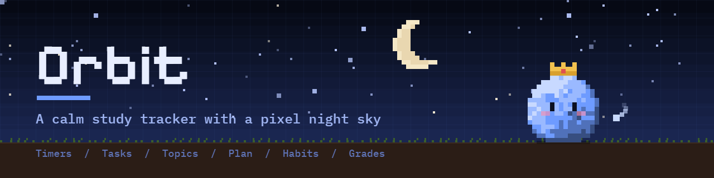
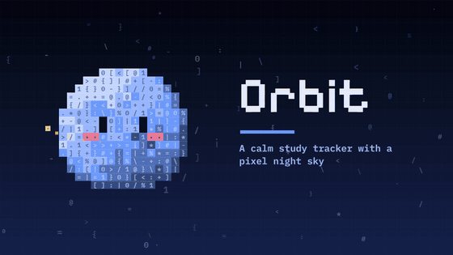
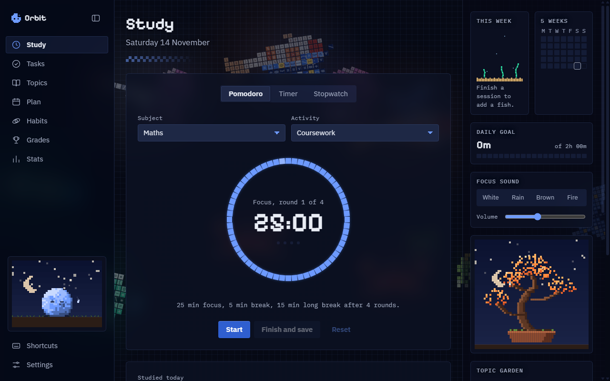

  

  <a href="https://george-coroi.github.io/study-log/"><b>Open Orbit</b></a>
  &nbsp;/&nbsp; Free &nbsp;/&nbsp; No install &nbsp;/&nbsp; No build step

  

  

Orbit is a study tracker for GCSE students, built by a GCSE student. It is plain HTML, CSS and JavaScript, so it opens in any browser. Built with Claude (Anthropic).

If it helps your revision, a star on this page helps other students find it.

## What it does

| Tab | What you get |
| --- | --- |
| **Study** | Pomodoro, timer and stopwatch. Every session has a subject and an activity. |
| **Tasks** | Separate school and personal to-do lists. |
| **Topics** | Topic lists with a confidence rating and last-revised date for each, plus revision reminders. Science follows OCR Gateway A. Maths (1MA1), Further Maths (7M20), Computer Science (1CP2), French (1FR1) and Italian (1IN0) follow the Pearson Edexcel specifications. History (8145) and Design and Technology (8552) follow AQA. You can edit any list. |
| **Plan** | A weekly revision plan with spaced-repetition suggestions. |
| **Habits** | Daily habits and a five-week heat map. |
| **Grades** | A tab for each subject, with target grades. |
| **Stats** | Daily and weekly totals. |

Study streaks count a day once you reach 30 minutes. There are four colour themes, and `?` shows the keyboard shortcuts.

## The pixel night sky

The look is a small pixel world that follows the clock and your progress.

- **Orbit, the moon blob** lives in the left sidebar. It hops by day and sleeps at night.
- **It studies with you.** While a focus timer runs it uses a prop for the subject: a scroll for History, a microscope for Biology, a flask for Chemistry, an atom for Physics, and more.
- **Outfits unlock with your total hours:** a sprout at 5, a cap at 20, a scarf at 50, a crown at 100.
- **The right-hand bar** has an aquarium that gains a fish for each session, a bonsai that fills out as you near your daily goal, a topic garden, and focus sounds (white, rain, brown, fire).

Add these to the web address to preview: `?hour=22` (time of day), `?study=biology` (a prop), `?outfit=100` (an outfit).

## Accounts and privacy

Without signing in, everything stays in your own browser. Sign in with Google to keep your log on every device.

- One record per person, holding only their study data. Nothing else is read from your Google account.
- Security rules (`firestore.rules`) mean you can only read and write your own record.
- Signing out clears the data from that device (it stays in your account), so shared computers stay private.
- The page uses a Content-Security-Policy, and the app never turns typed text into code.
- If you run your own copy and collect people's Google accounts, you are responsible for looking after them. For under-18s in the UK that means UK GDPR and the ICO Children's Code. Add a short privacy notice and a way to delete accounts.

## Run your own copy

1. **Host the files.** Put this folder in a public GitHub repository, then Settings > Pages > Deploy from branch `main`, folder `/ (root)`.
2. **Make a Firebase project** (free Spark plan) at console.firebase.google.com.
   - Build > Authentication > Get started > Sign-in method > turn on **Google**.
   - Authentication > Settings > Authorised domains > add `YOURNAME.github.io`.
   - Build > Firestore Database > Create database (production mode), then Rules > paste in `firestore.rules` > Publish.
   - Project settings > General > Your apps > Web (`</>`) > copy the config.
3. **Paste the config** into `firebase-config.js` and commit.

The Google button then appears in Settings > Account. Accounts do not work when you open `index.html` straight from your computer (Google blocks that), so use the hosted address.

## Files

| File | What it is |
| --- | --- |
| `index.html` | the whole app |
| `styles/` | colours, spacing and layout |
| `sprites.js`, `ascii-animals.html` | the animals |
| `cloud.js` | Google sign-in and saving to your account |
| `firebase-config.js` | your Firebase settings |
| `firestore.rules` | who can read and write what |
| `docs/` | the images on this page |

## Known limits

- The last change wins if you edit on two devices at once. A tab checks for newer data when you switch back to it.
- Each person's record is limited to about 900 KB (many thousands of sessions).
- The timer is not synced between devices, only your data.
- There is no backup button yet.
